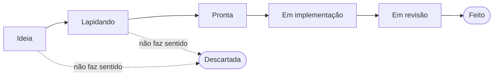

# Backlog

O backlog do Pebacast vive nas issues do GitHub, e o quadro do GitHub Projects dá a visão de Kanban. A regra é **capturar sem atrito e lapidar com rigor**: registrar uma ideia leva segundos, mas ela só vai para a implementação depois de virar um contrato que qualquer pessoa ou IA consegue executar sem perguntar nada.

## Fluxo



| Estado | Quem move | Como fica no GitHub |
|---|---|---|
| Ideia | Quem teve a ideia | Issue aberta pelo formulário *Ideia*, com o label `ideia`; entra no quadro sozinha |
| Lapidando | Lucas | Coluna do quadro |
| Pronta | Lucas, depois de conferir a Definition of Ready | Coluna do quadro e label `pronta` |
| Em implementação | Quem pegou: pessoa (fork) ou IA | Coluna do quadro e responsável na issue |
| Em revisão | Automático, quando o PR é aberto | PR com `Closes #<n>` |
| Feito | Automático, no merge | Issue fechada como concluída |
| Descartada | Lucas | Issue fechada como *not planned*, com o motivo num comentário |

**Por que um label só (`pronta`), e não um por estado?** As colunas do quadro são o fluxo do dia a dia, mas só se leem por GraphQL. O `pronta` é o portão de entrega para quem está de fora: um contribuidor filtra por ele e uma automação de IA consegue ler pela API REST. Repetir os outros estados em labels criaria duas fontes da verdade.

## Lapidar uma ideia

Reescreva o corpo da issue neste roteiro, mantendo a ideia original no fim:

```markdown
## Problema
O que dói hoje, para quem, e como sabemos.

## Por que importa
O ganho, ou o custo de não fazer.

## Proposta
O que muda, com o nível de detalhe que quem implementa precisa.

## Critérios de aceite
- [ ] Verificável, de fora: "a issue de reprovação fecha quando o episódio é publicado"
- [ ] ...

## Fora de escopo
O que parece fazer parte, mas não faz.

## Riscos e decisões
Trade-offs aceitos. Uma decisão de arquitetura vira ADR em `docs/adr/`.

## Documentação afetada
Quais docs mudam no mesmo PR (regra do `CLAUDE.md`): `fluxo-do-episodio.md`, `c4-negocio.md`, ADR...

---
Ideia original: ...
```

## Definition of Ready

A issue só ganha o label `pronta` quando todos os itens valem:

- [ ] O problema está claro sem precisar de contexto da cabeça de ninguém.
- [ ] Os critérios de aceite podem ser verificados por quem não escreveu a issue.
- [ ] Não há decisão em aberto: tudo que é "depende" foi decidido ou virou fora de escopo.
- [ ] A documentação afetada está listada.
- [ ] Cabe em um PR. Se não cabe, quebre em issues menores e feche esta como épico.

## Ideias de conteúdo

O que entra na fila de produção é o currículo (`curriculum/sagas/*.yaml`), não uma issue. Uma ideia de episódio é lapidada como as outras e, quando aprovada, vira uma entrada no YAML; o PR que adiciona a entrada fecha a issue. Assim a rotina continua lendo uma única fonte.

## Issues automáticas

As issues abertas pelos workflows (roteiro reprovado, falha na publicação, fallback de voz, watchdog) levam o label `incidente`. São avisos operacionais, não itens do backlog: não entram no quadro e fecham sozinhas quando o problema some.

## Montar o quadro (uma vez, na interface do GitHub)

1. No repositório, abra **Projects → New project → Board** e dê o nome **Pebacast**.
2. No campo **Status**, deixe as colunas: Ideia, Lapidando, Pronta, Em implementação, Em revisão, Feito.
3. Em **⋯ → Workflows**:
   - **Auto-add to project**: ligue com o filtro `is:issue -label:incidente`, apontando para este repositório.
   - **Item added to project**: Status = Ideia.
   - **Pull request linked to issue**: Status = Em revisão.
   - **Item closed** e **Pull request merged**: Status = Feito.
4. Em **Settings** do projeto, deixe a visibilidade **pública**, para quem vier por fork enxergar o que está pronto.
5. Com o quadro criado, adicione as issues abertas que já existem (o auto-add só pega as novas).
