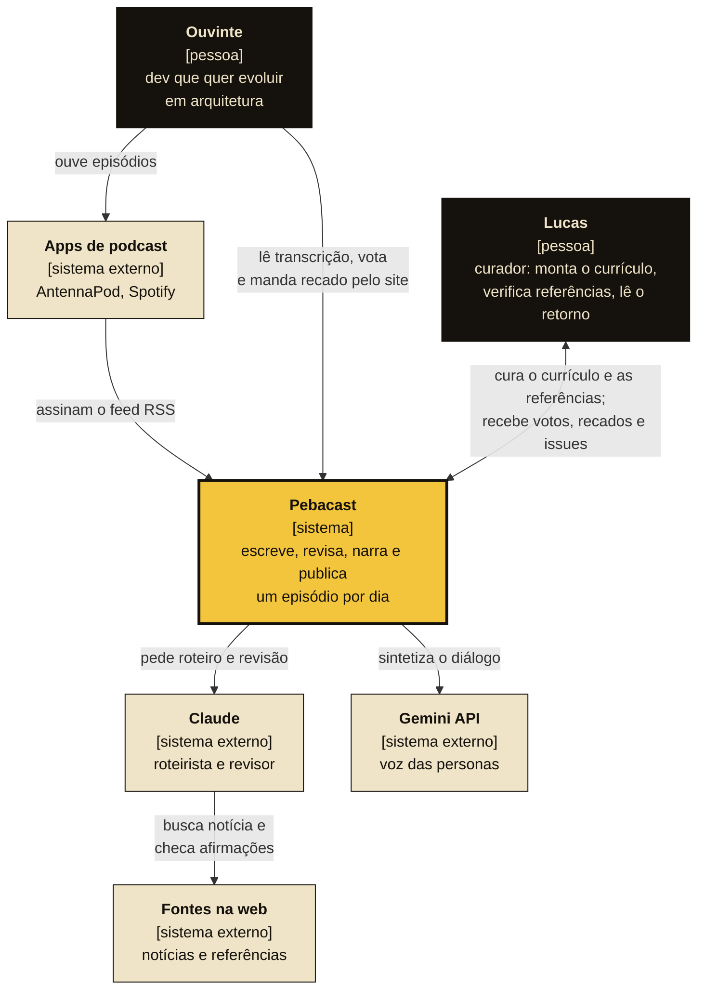
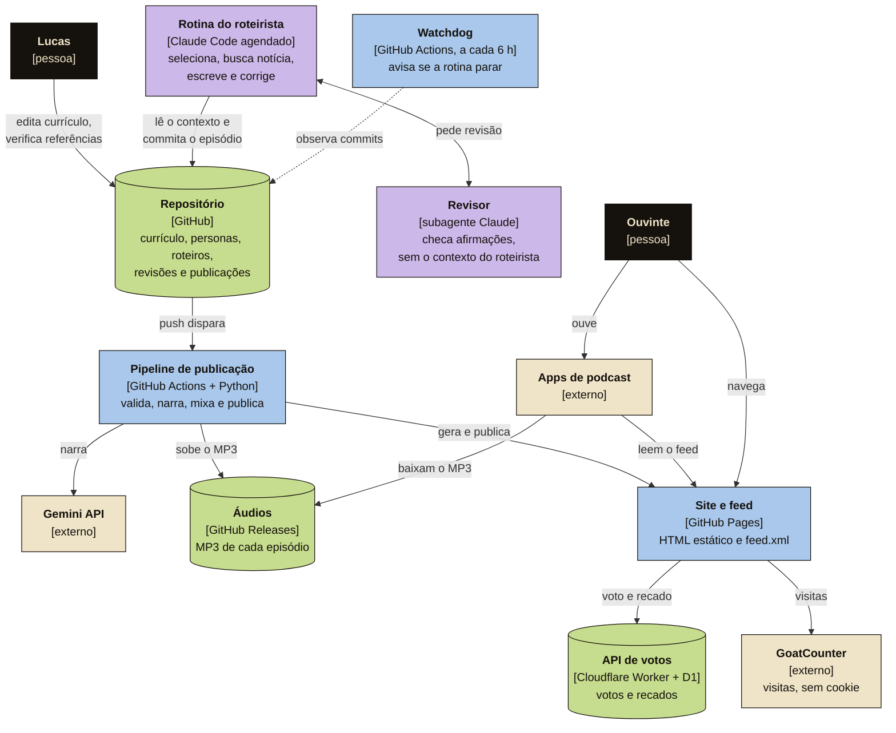

# Modelo C4 do Pebacast

Dois níveis do [modelo C4](https://c4model.com): o **contexto**, que mostra quem usa o Pebacast e do que ele depende, e os **contêineres**, que mostram as partes que entregam esse valor. Os níveis de componente e de código ficam no próprio código (`src/podcast/`, `votos/`).

## Nível 1 · Contexto

O Pebacast entrega todo dia uma conversa de 15 a 20 minutos sobre arquitetura de software, seguindo um currículo em 7 sagas. Os roteiros são escritos e revisados por IA, contra referências que o Lucas verificou.

| Elemento | Valor para o negócio |
|---|---|
| Ouvinte | Aprende arquitetura em doses diárias, a partir de casos reais e com o raciocínio dos trade-offs. |
| Lucas | Controla o que é ensinado (currículo e referências) sem escrever cada episódio. |
| Claude | Escala a escrita, e a revisão independente reduz o risco de afirmação errada. |
| Gemini API | Dá vozes distintas às personas. Sem ela, o fallback local sustenta a publicação, com qualidade menor. |
| Apps de podcast | Distribuição sem custo, pelo padrão RSS. |

## Nível 2 · Contêineres

Lilás é IA (Claude), azul é código (GitHub Actions e site estático), verde é onde os dados ficam e bege são serviços de terceiros. O único humano no desenho é o Lucas, que entra pelo repositório (currículo e referências) e pelo retorno. O Lucas lê os recados pelo console do D1 ([votos.md](votos.md)), e o Pipeline registra o `publicacao.json` de volta no repositório.

### Decisões que este desenho carrega

- **O repositório é a fonte da verdade.** O estado de cada episódio vem dos arquivos (`roteiro.json`, `revisoes/`, `publicacao.json`), não de um banco, e todo passo fica auditável no histórico ([ADR 0006](adr/0006-roteiro-por-rotina-claude.md)).
- **Julgamento separado de execução mecânica.** A IA escreve; o Actions não confia nela e valida de novo antes de gastar voz.
- **Custo zero de hospedagem.** Pages, Releases, Actions e o plano gratuito da Cloudflare ([ADR 0002](adr/0002-hospedagem-pages-releases.md), [ADR 0007](adr/0007-votos-worker-d1.md)).
- **Único dado dinâmico fora do GitHub:** votos e recados. O site estático continua sem servidor.
