# Fluxo do episódio, do início ao fim

Como um episódio sai do currículo e chega ao app de podcast. As etapas da rotina estão detalhadas em [pipeline.md](pipeline.md); a divisão entre rotina e Actions, no [ADR 0006](adr/0006-roteiro-por-rotina-claude.md).

Há três tipos de ator, um por cor:

| Cor | Ator | Papel |
|---|---|---|
| Rosa | **Humano** (Lucas) | Decide o que ensinar, libera episódios e reage ao retorno. Nada sai sem referências que ele verificou. |
| Lilás | **IA** (Claude) | Julga e escreve: escolhe a notícia, escreve o roteiro, revisa e corrige. |
| Azul | **Código** (GitHub Actions) | Determinístico: valida, narra, monta e publica. Não confia na IA. |

```mermaid
flowchart TD
    classDef humano fill:#f2a7bf,stroke:#15110c,color:#15110c,stroke-width:2px
    classDef rotina fill:#cdb8ea,stroke:#15110c,color:#15110c
    classDef actions fill:#a9c8ec,stroke:#15110c,color:#15110c
    classDef saida fill:#f2c53d,stroke:#15110c,color:#15110c
    classDef falha fill:#f2a46b,stroke:#15110c,color:#15110c
    classDef fim fill:#efe4c8,stroke:#15110c,color:#15110c

    subgraph H0["0 · Lucas (humano): prepara"]
        curriculo["Monta o currículo<br/>sagas, episódios, personas e vozes"]:::humano
        referencias["Verifica as referências do episódio<br/>(<code>referencias_verificadas: true</code>)"]:::humano
    end

    inicio([Rotina noturna do Claude dispara]):::rotina

    subgraph R["1 · Rotina do Claude (IA): escreve"]
        aguardando{Algum roteiro aprovado<br/>ainda não publicado?}
        selecao["Seleção (<code>roteiro contexto</code>)<br/>próxima saga da fila, pré-requisitos publicados,<br/>referências verificadas"]
        elegivel{Há episódio elegível?}
        noticia["Notícia: busca em 7 → 30 → 60 dias<br/>juiz dá nota de relevância; notícia já usada não vale"]
        relevante{Achou notícia<br/>acima da nota mínima?}
        hipotetico[Cenário hipotético,<br/>dito como tal no áudio]
        roteiro["Roteiro: diálogo apresentador × expert<br/>abertura, problema, solução ingênua,<br/>desconstrução, trade-offs, desafio"]
        revisao["Revisão N: subagente novo, sem contexto,<br/>checa cada afirmação contra as fontes"]
        aprovado{Aprovado?}
        limite{Ainda cabe outra revisão?}
        correcao[Corrige só as falas apontadas]
        validar_local{"<code>roteiro validar</code><br/>formato ok?"}
        commit["Commit de <code>episodios/&lt;id&gt;/</code><br/>e push na main"]
        nada([Nada a escrever hoje]):::fim
        reprovado_rotina([Commit da tentativa reprovada:<br/>o episódio não sai hoje]):::falha
    end

    subgraph A["2 · GitHub Actions (código): gera e publica"]
        validar_ci{Valida de novo:<br/>não confia na rotina}
        pronuncia[Aplica o dicionário de pronúncia]
        tts["Voz no Gemini TTS<br/>até 2 vozes por requisição"]
        erro_tts{Erro do Gemini?}
        retry[429 / 5xx: espera e tenta de novo]
        kokoro[Kokoro local, só se a API<br/>estiver fora ou sem acesso;<br/>publica e abre issue de aviso]
        mix["Vinheta + mixagem + loudnorm<br/>→ MP3"]
        release[Sobe o MP3 no GitHub Releases]
        registro["Grava <code>publicacao.json</code><br/>e commita"]
        feed[Gera feed.xml e o site]
        pages[Publica no GitHub Pages]
        issue([Issue aberta no repositório]):::falha
    end
    app([App de podcast baixa o episódio]):::saida
    site([Site mostra o episódio,<br/>com voto e recado]):::saida

    subgraph H1["3 · Lucas (humano): acompanha"]
        triagem["Lê a issue, corrige a causa<br/>e republica se preciso"]:::humano
        retorno["Lê votos e recados<br/>e ajusta o currículo"]:::humano
    end

    curriculo --> referencias
    referencias -. "libera para a fila" .-> selecao
    inicio --> aguardando
    aguardando -- sim --> nada
    aguardando -- não --> selecao --> elegivel
    elegivel -- não --> nada
    elegivel -- sim --> noticia --> relevante
    relevante -- sim --> roteiro
    relevante -- "não, nas 3 janelas" --> hipotetico --> roteiro
    roteiro --> revisao --> aprovado
    aprovado -- não --> limite
    limite -- sim --> correcao --> revisao
    limite -- não --> reprovado_rotina
    aprovado -- sim --> validar_local
    validar_local -- "não, e cabe revisão" --> correcao
    validar_local -- sim --> commit

    commit -- "push dispara publicar.yml" --> validar_ci
    reprovado_rotina -- push --> validar_ci
    validar_ci -- reprovado --> issue
    validar_ci -- ok --> pronuncia --> tts --> erro_tts
    erro_tts -- não --> mix
    erro_tts -- "429 / 5xx" --> retry --> tts
    erro_tts -- "4xx do pedido" --> issue
    erro_tts -- "401 / 403 ou<br/>tentativas esgotadas" --> kokoro --> mix
    mix --> release --> registro --> feed --> pages
    pages --> app
    pages --> site
    issue --> triagem
    site --> retorno

    class aguardando,selecao,elegivel,noticia,relevante,hipotetico,roteiro,revisao,aprovado,limite,correcao,validar_local,commit rotina
    class validar_ci,pronuncia,tts,erro_tts,retry,kokoro,mix,release,registro,feed,pages actions
```

## Fora do caminho principal

- **Watchdog** (`watchdog.yml`, a cada 6 h): abre uma issue se a rotina passar 36 h sem commitar roteiro, e fecha quando ela volta.
- **Site e feed** também são regenerados quando muda o site, o currículo ou a configuração (`site.yml`), sem gerar áudio.
- **Votos e recados** vivem fora do GitHub, num Worker da Cloudflare com D1 ([votos.md](votos.md)).
